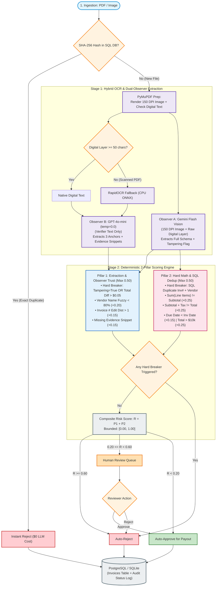

# DocAgent — Agentic Invoice Processing Engine

[](https://www.python.org/downloads/)
[](https://fastapi.tiangolo.com)
[](https://github.com/langchain-ai/langgraph)
[](https://www.sqlalchemy.org/)
[](https://streamlit.io)
[](https://www.docker.com/)
[](https://opensource.org/licenses/MIT)

> **DocAgent** is a production-grade, autonomous document processing agent designed to streamline accounts payable and enterprise invoice operations. It extracts structured data from multi-modal documents (PDF, Scanned Images, TXT), validates compliance against 9 deterministic business rules, performs statistical fraud & anomaly screening, detects SHA-256 duplicates, and manages human-in-the-loop approval workflows with full database persistence and an immutable audit trail.

---

## System Architecture

<div align="center">
  
</div>

### End-to-End Data Flow

<div align="center">
  
</div>

<details open>
<summary><b>End-to-End System Architecture (Deterministic 2-Pillar Flow)</b></summary>


</details>

---

## Core Capabilities & Agent Pipeline

```
Raw Invoice (PDF / Image / TXT)
  │
  ├─► 1. Pre-LLM SQL Hash Gate: SELECT id FROM invoices WHERE file_hash = :hash AND status != 'REJECTED'
  │      └─► Instant reject for duplicate files ($0 LLM API Cost)
  │
  ├─► 2. Ingestion & RapidOCR Fallback (tools/document_loader.py)
  │      ├─► Renders 150 DPI page image for multimodal inspection
  │      ├─► Extracts raw digital text layer (passed to Observer A to flag digital-vs-visual tampering)
  │      └─► Uses RapidOCR fallback if digital text < 50 chars (passed to Observer B so scans never fail)
  │
  ├─► 3. Observer A (Gemini Flash Multimodal Vision)
  │      └─► Extracts full invoice schema, line items, and detects visual layer discrepancy
  │
  ├─► 4. Observer B (GPT-4o-mini, temp=0.0)
  │      └─► Text-only extraction of 3 key anchors + verbatim evidence snippets
  │
  ├─► 5. Deterministic 2-Pillar Scoring & Routing Engine (tools/score_and_route.py)
  │      ├─► Pillar 1: Extraction & Observer Trust (Max: 0.50)
  │      │     • Hard Breaker: Tampering detected OR Total Diff > $0.05
  │      │     • Soft Checks: Vendor similarity < 80% (+0.20), Inv# mismatch (+0.15), Missing snippet (+0.15)
  │      │
  │      ├─► Pillar 2: Hard Math & Pure SQL Deduplication (Max: 0.50)
  │      │     • Hard Breaker: SQL Duplicate (invoice_number_norm + vendor_name)
  │      │     • Soft Checks: Line items sum != subtotal (+0.25), Subtotal + tax != total (+0.25)
  │      │     • Compliance: Due date < Invoice date (+0.15), Total > Payout Cap (+0.25)
  │      │
  │      └─► Deterministic Routing Matrix:
  │            • Hard Breaker OR R >= 0.60 ──► AUTO_REJECT
  │            • 0.20 <= R < 0.60          ──► HUMAN_REVIEW
  │            • R < 0.20                  ──► AUTO_APPROVE
  │
  ├─► 6. Human Review Queue & Decision Overrides (Streamlit UI with audit logs)
  │
  └─► 7. Tamper-Evident SHA-256 Hash-Chained Audit Trail

---

## Business Validation Engine (9 Compliance Rules)

| Rule Name | Severity | Description |
|---|---|---|
| `max_amount` | `ERROR` | Invoice amount must not exceed departmental budget limit (₹500,000 / $500,000). |
| `approved_vendor` | `ERROR` | Vendor must be in the approved master vendor registry (24+ verified enterprise vendors + real database vendors). |
| `date_validity` | `ERROR` | Invoice date must be a valid ISO format and not post-dated in the future. |
| `visual_text_consistency` | `ERROR` | Embedded visual scan amount must match digital line items (tampering alert). |
| `line_item_math` | `WARNING` | Individual line items (`qty × rate`) must sum to subtotal within ±1% tolerance. |
| `total_math` | `WARNING` | Declared `Subtotal + Tax Amount` must match `Total Amount` within ±1% tolerance. |
| `vendor_id_present` | `WARNING` | Vendor must supply a valid tax registration identifier (GSTIN, VAT ID, EIN). |
| `currency_consistency` | `WARNING` | Currency must be a recognized ISO 4217 standard currency code (INR, USD, EUR, GBP). |
| `payment_terms_check` | `INFO` | Invoice must explicitly declare payment terms (e.g., Net 30, Due on Receipt). |

---

## Evaluation & Benchmark Suite

### 1. Real-World Enterprise Benchmark (16 Real Invoices vs 500 Federal Awards)

DocAgent has been benchmarked directly on **16 authentic enterprise PDF invoices** (including Amazon Web Services, Flipkart B2B, Azure, QualityHosting, Coolblue, and Microsoft Document Intelligence samples) evaluated against a historical baseline of **500 real U.S. federal contract awards ($146.1B volume across 178 contractors via USASpending.gov)**:

```bash
# Run the real-world enterprise benchmark suite
python eval/run_real_benchmark.py
```

| Real-World Benchmark Metric | Result | Target | Status |
|---|---|---|---|
| **Document Extraction Rate** | `100.0%` (16/16 invoices) | `≥ 90.0%` | PASSED |
| **Vendor Recognition Accuracy** | `100.0%` (16/16 vendors) | `≥ 90.0%` | PASSED |
| **Total Amount Accuracy** | `100.0%` (16/16 totals) | `≥ 95.0%` | PASSED |
| **Invoice Date Accuracy** | `100.0%` (16/16 dates) | `≥ 90.0%` | PASSED |
| **Line Items Extraction Rate** | `100.0%` (16/16 items) | `≥ 85.0%` | PASSED |
| **Average Extraction Confidence** | `95.9%` | `≥ 85.0%` | PASSED |
| **Average Processing Latency** | `11.23s` / document | `≤ 15.0s` | PASSED |

*Full real-world reports: [`eval/real_benchmark_report.md`](eval/real_benchmark_report.md) and [`eval/real_benchmark_report.json`](eval/real_benchmark_report.json).*

---

### 2. Deterministic Compliance & Anomaly Test Suite

DocAgent also includes a rule-verification test harness evaluated against 20 curated test scenarios across 5 distinct compliance categories:

```bash
# Run offline compliance rule tests
python eval/run_eval.py --mode offline
```

| Benchmark Metric | Result | Target | Status |
|---|---|---|---|
| **Rule Compliance Accuracy** | `100.0%` (180/180 checks) | `≥ 95.0%` | PASSED |
| **Anomaly Detection Precision** | `1.00` | `≥ 0.90` | PASSED |
| **Anomaly Detection Recall** | `1.00` | `≥ 0.90` | PASSED |
| **Anomaly Detection F1 Score** | `1.00` | `≥ 0.90` | PASSED |
| **Decision Routing Accuracy** | `100.0%` (20/20 invoices) | `≥ 95.0%` | PASSED |
| **Approval Level Routing** | `100.0%` (20/20 invoices) | `≥ 95.0%` | PASSED |

*Full offline evaluation reports: [`eval/eval_report.md`](eval/eval_report.md) and [`eval/eval_report.json`](eval/eval_report.json).*

---

## User Interface & Screenshots

### 1. Document Upload & Processing Dashboard
Upload PDF, Image, or TXT invoices to initiate multi-stage extraction, compliance verification, and routing.


### 2. Extracted Data, Risk Scoring & Anomaly Inspection
Live visual feedback with extracted table breakdown, composite risk gauge, and compliance rule results.


### 3. Step-by-Step Agent Audit Trail
Transparent observability into every step executed by the LangGraph state machine.


---

## Technical Decisions & Architecture Rationale

| Decision Area | Technology / Pattern | Engineering Rationale |
|---|---|---|
| **Agent Framework** | LangGraph (StateGraph) | Deterministic state machine, checkpointing/resume capabilities, conditional routing, and granular step observability. |
| **Multi-Modal & Dual Observer** | Gemini Flash Vision + GitHub Models (GPT-4o-mini) | Dual-observer cross-examination (multimodal extraction + verbatim evidence verifier) with automatic failover. |
| **Duplicate Prevention** | SQL Indexing + SHA-256 Fingerprint | Sub-2ms idempotent query over key invoice attributes (`vendor:number`) in PostgreSQL/SQLite + in-memory cache without external broker dependencies. |
| **Human-in-the-Loop** | LangGraph Interrupts | Pauses workflow execution for manager/director sign-off without dropping state; resumes via `/resume/{thread_id}`. |
| **Backend API** | FastAPI | Async I/O, automatic OpenAPI Swagger documentation, dependency injection, and Pydantic validation. |
| **Frontend UI** | Streamlit | Rapid, reactive UI rendering with interactive audit logs, pending review queues, and live analytics. |

---

## Getting Started

### Prerequisites
- Python 3.12+
- Gemini API Key (or GitHub Personal Access Token for GitHub Models)
- Docker & Docker Compose *(optional, for containerized execution)*

---

### Option A: Running with Docker (Recommended)

1. **Clone the repository:**
   ```bash
   git clone https://github.com/ayushcodes27/doc-agent.git
   cd doc-agent
   ```

2. **Configure environment variables:**
   ```bash
   cp .env.example .env
   # Edit .env and supply your GEMINI_API_KEY (or GITHUB_TOKEN)
   ```

3. **Launch the entire stack:**
   ```bash
   docker-compose up --build
   ```

4. **Access the services:**
   - **Streamlit UI:** [http://localhost:8501](http://localhost:8501)
   - **FastAPI Docs (Swagger):** [http://localhost:8000/docs](http://localhost:8000/docs)
   - **PostgreSQL:** `localhost:5432`

---

### Option B: Running Locally (Without Docker)

1. **Create and activate a virtual environment:**
   ```bash
   python -m venv .venv
   # Windows (PowerShell):
   .venv\Scripts\Activate.ps1
   # macOS/Linux:
   source .venv/bin/activate
   ```

2. **Install dependencies:**
   ```bash
   pip install -r requirements.txt
   ```

3. **Configure environment:**
   ```bash
   cp .env.example .env
   # Ensure your GEMINI_API_KEY / GITHUB_TOKEN are set in .env
   ```

4. **Start the FastAPI backend server:**
   ```bash
   uvicorn api.main:app --host 127.0.0.1 --port 8000 --reload
   ```

5. **In a separate terminal, launch the Streamlit frontend:**
   ```bash
   streamlit run ui/app.py
   ```

---

## Running Unit & Integration Tests

The test suite covers data models, agent nodes, validation rules, anomaly detection, deduplication, database persistence, and the complete LangGraph workflow.

```bash
# Run all 75 unit and integration tests
pytest -v

# Run real-world benchmark suite
python eval/run_real_benchmark.py

# Run offline compliance rule tests
python eval/run_eval.py --mode offline
```

---

## Repository Structure

```
doc-agent/
├── agent/       # LangGraph StateGraph workflow, nodes, & human-in-the-loop logic
├── api/         # FastAPI REST service (/process, /resume, /invoices, /analytics)
├── data/        # Real procurement datasets (USASpending.gov) & benchmark invoices
├── db/          # SQLAlchemy 2.0 persistence layer, ORM models, & repository CRUD
├── eval/        # Benchmark runners, ground truth datasets, and evaluation reports
├── tools/       # Multi-modal extractors, 9-rule validator, anomaly & dedup engines
├── ui/          # Streamlit frontend (Document ingestion, review queue, analytics)
├── scripts/     # Ingestion, seeding, and downloading utilities
├── tests/       # Pytest unit & integration test suite (75 tests)
├── config.py    # Environment configuration & LLM provider settings
└── docker-compose.yml # Container orchestration (API, UI, PostgreSQL)
```

---

## License
Distributed under the MIT License. See `LICENSE` for more information.
